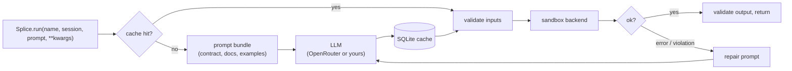

# Splice

**Describe a function in plain English, call it like any other Python function, and let Splice generate it once, cache it, and run it inside a hardened sandbox.**

Splice is for the parts of an app where users get to decide what the code does: a calculator whose `?` operator means whatever you say it means, a pricing rule a customer types into a form, a data transform described in a ticket. You declare the contract once in YAML. Splice turns each prompt into a typed function with an LLM, caches it per session, checks inputs and outputs against the contract, repairs it when it breaks, and never lets it run in your process.

```python
from splice import Session, Splice

sp, session = Splice(), Session.ensure()

sp.run("blend", session=session, prompt="Return the hypotenuse of a and b", a=3.0, b=4.0)  # 5.0
sp.run("blend", session=session, a=5.0, b=12.0)  # 13.0, served from cache, no model call
```

```text
$ python examples/quickstart.py
sandbox backend: seatbelt

blend(4, 6)             -> 5.0
20 more calls           -> 47 ms each, model calls so far: 1
credential grab         -> blocked: import of module 'os' is not in sandbox.allow_imports
harmonic(3, 6)          -> 4.0  (after one repair round)
```

## Features

- **Prompt to function, once.** The first call in a session generates the code; every later call reuses it.
- **Contracts in YAML.** Signature, input and output types, optional pydantic models, few-shot examples and context docs, all bundled into a deterministic prompt.
- **Session-scoped cache.** SQLite, keyed by session plus hashes of the prompt, spec, context docs and config. Change any of them and the code regenerates.
- **Self-repair.** Runtime errors, sandbox violations and bad return values go back to the model as a repair prompt.
- **A real sandbox.** Fresh interpreter per call, scrubbed environment, CPU/memory/file/output limits, an audit-hook policy engine, and a kernel sandbox on top: Seatbelt on macOS, bubblewrap namespaces on Linux, or locked-down Docker/Podman containers.
- **Pluggable.** Bring your own model client or sandbox backend in a few lines.
- **Typed and tested.** `mypy --strict`-style settings, 180+ tests, and an escape suite that runs on Linux, macOS and Docker in CI.

## How it works



**A spec** declares the contract. `.splice/functions/blend.yaml`:

```yaml
name: blend
version: 0.1.0
description: Combine two numbers in a way the caller describes in plain English.
prompt: ""
contracts:
  signature: "def blend(a: float, b: float) -> float"
  inputs: {a: float, b: float}
  output: float
examples:
  - prompt: Return the larger of the two numbers
    function: |
      def blend(a: float, b: float) -> float:
          return max(a, b)
```

**The cache key** is `(session, function, sha256(prompt), sha256(spec), sha256(context docs), sha256(splice.yaml))`. Sessions keep users apart: two people can define `blend` differently and never see each other's code. Within a session the prompt is only needed once. Edit the spec, a context doc or the sandbox policy and the next call regenerates under the new rules. Artifacts expire after `sessions.ttl`, a successful repair overwrites the broken version, and `run_now=False` generates without executing. Every generation and execution is logged with timings in the same database.

## Sandbox security model

Splice treats generated code as hostile, including code it generated itself an hour ago. Every call crosses three layers:

| Layer | What it does |
| --- | --- |
| **Language guard** | Parses the source first. Rejects imports outside the allowlist, dunder access (`__class__`, `__globals__`, `__subclasses__`), `eval`/`exec`/`getattr`/`globals`, and frame walking. Allowed modules are read-only views that refuse to hand out other modules, which closes the `statistics.sys.modules["os"]` trick. |
| **Process isolation** | A brand-new `python -I -B` in a private `0700` temp dir. The environment is rebuilt from nothing, so `OPENROUTER_API_KEY` and friends never arrive. rlimits and a parent-side watchdog cap CPU time, memory, file size, open files and process creation. A CPython audit hook denies file access outside the interpreter's install, sockets and DNS, `subprocess`/`fork`/`exec`, `ctypes`, `gc` walks and hook tampering. Results come back as tagged JSON; the parent never unpickles anything. The parent SIGKILLs the process group on timeout, memory or output overrun. |
| **OS sandbox** | `seatbelt` (macOS): deny-by-default kernel profile, no network, no fork. `bubblewrap` (Linux): private user/mount/PID/network namespaces where your home directory does not exist. `docker`/`podman`: `--network none`, read-only rootfs, all capabilities dropped, non-root, cgroup limits. |

Filesystem, network and subprocess access are off by default. Turning `allow_fs` on grants a scratch directory, never the host filesystem.

The escape suite in [`tests/test_sandbox_escapes.py`](tests/test_sandbox_escapes.py) runs every attack against every available backend, then again with the language guard switched off, then once more as raw Python under the kernel profile with no runner at all:

| Attack | Result |
| --- | --- |
| Read `~/.ssh/id_ed25519`, list the home directory | `SandboxViolation`; kernel: permission denied |
| Read `OPENROUTER_API_KEY` / `AWS_SECRET_ACCESS_KEY` | not present in the sandbox |
| Connect to a local port, resolve DNS | `SandboxViolation`; kernel: unreachable |
| `subprocess`, `os.system`, `multiprocessing`, fork bomb | `SandboxViolation` |
| `while True: pass`, `time.sleep(60)`, CPU spin | `ExecutionTimeout` / `ResourceLimitExceeded` |
| `bytearray(3 GiB)`, gradual allocation, 8 MiB result | `ResourceLimitExceeded` |
| Subclass walk, module pivot, `__globals__`, frame walk | `SandboxViolation` |
| `sys.addaudithook`, `gc.get_objects`, `ctypes.CDLL` | `SandboxViolation` |
| Return an object whose `__reduce__` runs a shell command | `SerializationError`; nothing executes in the parent |

`splice sandbox` shows what your machine supports:

```text
$ splice sandbox
configured: auto  ->  using: seatbelt

  [yes] process     fresh interpreter, scrubbed env, private temp dir, rlimits, audit-hook policy
  [yes] seatbelt    process sandbox + kernel deny-by-default profile: no network, no fork/exec, no reads outside the interpreter
  [no ] bubblewrap  process sandbox + private mount/pid/net/user namespaces (host filesystem invisible)
  [no ] docker      throwaway container: no network, read-only rootfs, no capabilities, cgroup limits
  [no ] podman      throwaway container: no network, read-only rootfs, no capabilities, cgroup limits

limits: timeout=10s cpu=10s memory=512MB file=16MB
policy: fs=off net=off subprocess=off imports=math, statistics, numpy
```

The full threat model is in [docs/security.md](docs/security.md).

## Quickstart

```bash
git clone https://github.com/joey12725/splice.git && cd splice
python -m venv .venv && source .venv/bin/activate
pip install -e ".[dev]"

python examples/quickstart.py                                   # offline, no API key
python examples/calculator_demo.py --offline --define hypot "3?4" "5?12"
```

With a real model:

```bash
export OPENROUTER_API_KEY=...
splice init                  # .splice/ with functions/, context/, splice.yaml
splice edit --add-func my_op # scaffold a spec, then edit the contract
```

```python
from splice import Session, Splice

session = Session.ensure()
Splice().run("my_op", session=session, prompt="Return (a + b) / 2", a=2.0, b=4.0)  # 3.0
```

Python 3.10+ on macOS or Linux. On Linux, install `bubblewrap` to get the namespace sandbox.

## Configuration

Everything lives in `.splice/splice.yaml`. The sandbox section:

```yaml
sandbox:
  backend: auto              # auto | process | seatbelt | bubblewrap | docker | podman
  allow_imports: ["math", "statistics", "numpy"]
  allow_fs: false            # scratch dir only
  allow_net: false
  allow_subprocess: false
  timeout_seconds: 10
  cpu_seconds: 10
  memory_mb: 512
  max_file_size_mb: 16
  env_passthrough: []        # nothing from your environment unless named here
```

See [docs/guide/config.md](docs/guide/config.md) for every key.

## Extending

Any object with `generate_code(bundle, config) -> str` can replace the OpenRouter client, and any `splice.Sandbox` subclass can replace the backend:

```python
from splice import Splice, register_backend
from splice.sandbox import ProcessSandbox


class FirejailSandbox(ProcessSandbox):
    name = "firejail"

    def wrap_command(self, command, *, workdir, policy, python):
        return ["firejail", "--quiet", "--net=none", f"--private={workdir}", *command]


register_backend("firejail", FirejailSandbox)   # now selectable as sandbox.backend: firejail
sp = Splice(client=MyGenerator(), sandbox=FirejailSandbox())
```

Subclassing `ProcessSandbox` keeps the runner, limits, audit hook and error mapping, so a new OS wrapper is a single method. More in [docs/extending.md](docs/extending.md).

## Project layout

```text
splice/
  core.py          Splice.run: cache, generate, validate, execute, repair
  sandbox/         Sandbox interface, registry and backends
    _runner.py     stdlib-only bootstrap that runs inside the sandbox + JSON codec
    process.py     fresh interpreter, rlimits, watchdogs, process-group kill
    seatbelt.py    macOS sandbox-exec profile
    bubblewrap.py  Linux namespaces
    container.py   Docker / Podman
  store.py         SQLite cache and event log
  prompt.py        deterministic prompt bundling
  client.py        OpenRouter client
  specs.py, config.py, validation.py, deps.py, docgen.py, cli.py
examples/          offline quickstart and the ? calculator
docs/              architecture, security model, guides
```

## Development

```bash
pytest                       # 180+ tests; backends your machine lacks are skipped
ruff check . && ruff format --check . && mypy splice
SPLICE_TEST_CONTAINERS=1 pytest tests/test_sandbox_escapes.py -k docker   # needs Docker
```

## Tech stack

Python 3.10+, httpx, PyYAML, SQLite, CPython audit hooks, POSIX rlimits, macOS Seatbelt, bubblewrap, Docker/Podman. OpenRouter for models by default. pytest, ruff, mypy and GitHub Actions for the toolchain.

---

Built by [Joey Hersh](https://github.com/joey12725). MIT licensed; see [LICENSE](LICENSE). Release notes in [CHANGELOG.md](CHANGELOG.md).
