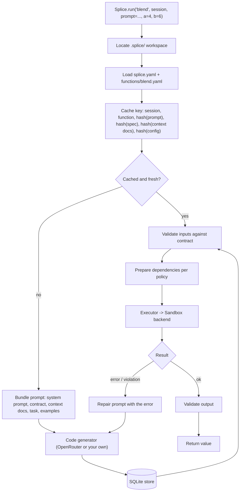

# Architecture

Splice is a small library with a clear pipeline: a spec and a prompt go in, a
cached function comes out, and every call to that function runs in a sandbox.



## Modules

| Module | Role |
| --- | --- |
| `splice.core` | `Splice` and `Session`. Orchestrates cache lookup, generation, validation, execution and repair. |
| `splice.specs` | Loads and validates `functions/<name>.yaml`. |
| `splice.config` | Loads and validates `splice.yaml` into typed dataclasses. |
| `splice.prompt` | Deterministic prompt bundling. Same inputs, same bytes. |
| `splice.client` | `OpenRouterClient`: retries, reasoning-effort mapping, fenced-code extraction. |
| `splice.store` | SQLite cache of generated code plus an event log (generation and execution timings, failures). |
| `splice.validation` | Contract checks on the way in and out (`isinstance` or a pydantic model). |
| `splice.deps` | Dependency policy and per-session virtualenvs. |
| `splice.executor` | Parses the contract signature and hands the call to a sandbox. |
| `splice.sandbox` | The `Sandbox` interface, backend registry and the five built-in backends. |
| `splice.sandbox._runner` | Standard-library-only bootstrap that runs *inside* the sandbox, plus the JSON value codec shared by both sides. |
| `splice.cli` | `splice init`, `edit`, `sandbox`, `cache purge`, `docgen`, `make-func`. |
| `splice.docgen` | Introspects classes into Markdown context docs. |

## Caching

Generated code is stored per session in `.splice/db.sqlite`, keyed by:

```
(session_id, function_name, sha256(prompt), sha256(spec YAML),
 sha256(context docs), sha256(splice.yaml))
```

- **Sessions scope behaviour.** The prompt that defines a function belongs to a
  session. Two users can define `?` differently and never see each other's
  code.
- **Any input change regenerates.** Edit the spec, a context doc, or the
  config (model, sandbox policy, ...) and the next call generates fresh code.
- **Prompt optional after the first call.** Within a session, a call without
  `prompt=` reuses the most recent code generated for that function under the
  current spec, docs and config.
- **TTL.** `sessions.ttl` (`30m`, `24h`, `7d`) expires artifacts by creation
  and last use; expired rows are purged on the next call.
- **Repairs overwrite.** When a repair succeeds, the fixed code replaces the
  broken artifact under the same key, so the next call starts from working code.
- **Generate-only.** `run_now=False` generates and caches without executing.

Every generation, execution and failure is written to the `events` table with
timings, which makes it easy to see what the model produced and when.

## The sandbox boundary

The executor builds an `ExecutionRequest` (source, function name, expected
parameters, arguments) and a `SandboxPolicy` (allowed imports, fs/net/process
switches, resource limits, env passthrough) and calls `Sandbox.execute`.

Local backends start `python -I -B _splice_runner.py` in a private temp
directory, optionally wrapped by `sandbox-exec` or `bwrap`. The parent writes
one JSON request to stdin; the runner applies rlimits, checks the source,
installs the audit hook, runs the function and writes one line,
`<nonce> <json>`, to stdout. Anything the function prints is captured
separately, so it can never be mistaken for the result.

See [security.md](security.md) for the full threat model.
