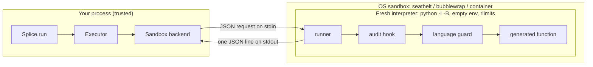

# Sandbox security model

Splice runs code that a language model wrote a few seconds ago. It treats that
code as untrusted, every time, including code served from the cache. This page
describes the boundary it runs behind.

## Threat model

The adversary is the generated function. It may be wrong, it may be prompt
injected through a context doc, or the model may simply decide that reading
`~/.ssh` is a good idea. Splice assumes the code will try to:

- read files on the host (SSH keys, cloud credentials, the project source),
- read secrets from the environment (`OPENROUTER_API_KEY`, `AWS_*`, tokens),
- talk to the network (exfiltration, or calling internal services),
- start processes (shells, fork bombs),
- burn resources (infinite loops, huge allocations, giant files, output floods),
- escape the language-level restrictions (`().__class__.__subclasses__()`,
  `statistics.sys.modules["os"]`, frame walking, `ctypes`),
- attack the parent through its return value (a pickle payload).

The parent process, the spec files and `splice.yaml` are trusted. They are
written by you.

## Three layers

Every call goes through all three, and the test suite exercises each one on its
own. Beating one layer still leaves the other two in the way.

### 1. Language guard (restricted Python)

Before anything runs, the runner parses the generated source and rejects:

- imports outside `sandbox.allow_imports`, and filesystem, network or process
  modules unless the matching `allow_*` switch is on,
- dunder attribute access (`__class__`, `__globals__`, `__subclasses__`, ...)
  apart from harmless ones such as `__name__` and `__init__`,
- frame and generator internals (`f_back`, `gi_frame`, `tb_frame`, ...),
- dangerous builtins by name (`eval`, `exec`, `compile`, `getattr`, `globals`,
  `__import__`, `open` unless filesystem access is on).

Allowed modules are handed to the code as read-only views. A view refuses to
return any submodule whose top-level package is not on the allowlist, which
closes the `statistics.sys.modules["os"]` pivot that defeats most import
allowlists.

### 2. Process isolation

The code never runs in your process. Each call gets a brand-new interpreter:

| Control | Mechanism |
| --- | --- |
| No shared memory | Fresh `python -I -B` per call (no fork of the parent) |
| No inherited secrets | Environment built from scratch: `PATH`, locale, `HOME`/`TMPDIR` pointing at the scratch dir, plus only the names in `sandbox.env_passthrough` |
| Private scratch space | `0700` temp directory, deleted after the call |
| Wall clock | Parent SIGKILLs the whole process group at `timeout_seconds` |
| CPU | `RLIMIT_CPU` (`cpu_seconds`) |
| Memory | `RLIMIT_AS` on Linux; physical-footprint watchdog on macOS; cgroup limit in containers |
| File size | `RLIMIT_FSIZE` (`max_file_size_mb`) |
| File descriptors | `RLIMIT_NOFILE` (`max_open_files`) |
| Process creation | `RLIMIT_NPROC = 0` after start-up, so `fork()` fails |
| Output | stdout/stderr and the encoded result are capped at `max_output_kb` |
| Policy enforcement | A CPython audit hook denies opening files outside the interpreter's own install, writing anywhere but the scratch dir, sockets and DNS, `subprocess`/`os.system`/`fork`/`exec`, `ctypes`, `gc` walks, frame access, and adding or replacing audit hooks |
| Safe results | Values return as tagged JSON. The parent never unpickles anything the sandbox produced |

If the code catches a denial and carries on, the attempt is still reported
and the call fails with `SandboxViolation`. The hook writes each denial to the
result channel the moment it happens, and it is built only from values
captured in its own closure, so code that rebinds the runner's globals,
`os.path.realpath` or builtins changes nothing about what the hook allows.
Readable paths are the interpreter install and its `site-packages`; project
roots that editable installs add to `sys.path` are pruned before the code runs.

### 3. OS sandbox

On top of the process layer, the default `auto` backend adds a kernel-enforced
boundary when the platform has one:

| Backend | Boundary |
| --- | --- |
| `seatbelt` (macOS) | `sandbox-exec` with a deny-by-default profile. Reads are limited to system libraries, the interpreter's install and the scratch dir; writes to the scratch dir (with `allow_fs`); no network; no `fork`; `exec` only inside the interpreter's install. |
| `bubblewrap` (Linux) | New user, mount, PID, IPC, UTS, cgroup and network namespaces. The mount namespace contains only `/usr`, the interpreter and the scratch dir, all read-only except the scratch dir with `allow_fs`. The host's home directory does not exist inside. |
| `docker` / `podman` | Throwaway container per call: `--network none`, `--read-only`, `--cap-drop ALL`, `no-new-privileges`, UID 65534, cgroup memory/CPU/PID limits, tmpfs scratch dir. |
| `process` | The process layer alone. Used when no OS sandbox is available. |

`splice sandbox` shows which backends this machine supports and which one the
workspace will use.

## What the tests prove

`tests/test_sandbox_escapes.py` runs every attack against every available
backend, once with the language guard on and once with it off
(`restricted_python=False`, simulating an attacker who has already beaten it).
`TestKernelLayer` then runs raw Python under the OS wrapper with no runner, no
audit hook and no rlimits, so only the kernel sandbox is in play.

| Attack | Expected result |
| --- | --- |
| Read a fake `~/.ssh/id_ed25519` outside the sandbox | `SandboxViolation`; kernel layer: permission denied |
| List the real home directory | `SandboxViolation`; kernel layer: permission denied |
| Read `OPENROUTER_API_KEY` / `AWS_SECRET_ACCESS_KEY` from the environment | Variables are absent |
| Connect to a listening localhost port, resolve DNS | `SandboxViolation`; kernel layer: unreachable |
| `subprocess.run`, `os.system`, `multiprocessing` | `SandboxViolation` |
| Fork bomb | `SandboxViolation`; kernel layer (macOS): fork denied |
| `while True: pass`, `time.sleep(60)` | `ExecutionTimeout` |
| Pure CPU spin with a generous wall clock | `ResourceLimitExceeded` (CPU) |
| `bytearray(3 GiB)`, gradual 16 MiB growth | `ResourceLimitExceeded` (memory) |
| Write a 4 MiB file with a 1 MiB cap | The write fails (`EFBIG`) |
| Write outside the scratch dir with `allow_fs` on | `SandboxViolation` |
| Read the project tree (on `sys.path` via an editable install) | `SandboxViolation` |
| Rebind the runner's helpers, `os.path.realpath` and builtins, then read a secret | `SandboxViolation` |
| 8 MiB return value | `ResourceLimitExceeded` (output) |
| Subclass walk, module pivot, `eval`, `getattr`, frame walk, `__globals__` | `SandboxViolation` |
| `sys.addaudithook`, `gc.get_objects`, `ctypes.CDLL` | `SandboxViolation` |
| Return an object whose `__reduce__` runs `os.system` | `SerializationError`; the parent never deserializes it |

CI runs the suite on Linux (process and bubblewrap, Python 3.10 to 3.13), on
macOS (process and seatbelt) and against the Docker backend.

## Choosing a backend

- **Laptops and CI:** leave `backend: auto`. You get seatbelt on macOS and
  bubblewrap on Linux (`apt install bubblewrap`).
- **Servers handling untrusted prompts from users:** use `docker` or `podman`
  for a separate kernel namespace and cgroup per call, and keep
  `allow_net: false`.
- **Your own sandbox (Firecracker, gVisor, a remote runner):** implement
  `splice.Sandbox` and register it. See [extending](extending.md).

Opting in to `allow_net` or `allow_subprocess` widens the boundary on purpose;
the kernel profiles follow the same switches.
